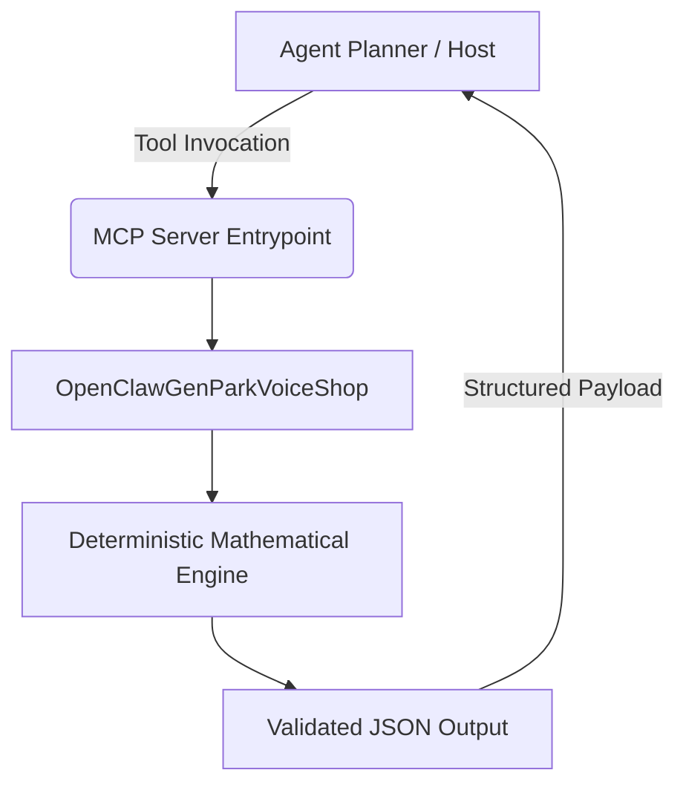

# openclaw-genpark-voice-shop

[](https://github.com/Alpha-Park/openclaw-genpark-voice-shop)
[](requirements.txt)
[](https://modelcontextprotocol.io/)
[](https://opensource.org/licenses/MIT)
[](https://github.com/Alpha-Park/openclaw-genpark-voice-shop)

Production-grade agentic skill designed for the OpenClaw and GenPark swarms. The core client uses the Python standard library; the MCP server requires the official `mcp` SDK.

## MCP runtime requirements

Use Python 3.10 or newer. The core `client.py` uses only the standard library; `mcp_server.py` requires the official `mcp` SDK (`mcp>=1.0.0,<2`). From this repository's checkout, create an isolated environment and install its requirements:

```bash
python -m venv .venv
.venv/bin/python -m pip install -r requirements.txt
```

On Windows, use `.venv\Scripts\python.exe` instead. You may use an existing Python environment with the requirements installed. Configure your MCP client with that interpreter's absolute path and the absolute path to `mcp_server.py`. The client launches a local STDIO process; the GitHub repository URL is not a remote MCP endpoint.

## Architecture & Flow



## Features

- **Standard-Library Core**: Direct `client.py` use needs no external packages; the MCP server requires the `mcp` SDK.
- **Model Context Protocol (MCP)**: Native FastMCP JSON-RPC interface for Claude, Cursor, and OpenClaw agents.
- **Pure Mathematical Rigor**: Verifiable algorithmic closed-form calculations and deterministic results.
- **Public Source**: Maintained in the [Alpha-Park repository](https://github.com/Alpha-Park/openclaw-genpark-voice-shop).

## Installation & Usage

```bash
git clone https://github.com/Alpha-Park/openclaw-genpark-voice-shop.git
cd openclaw-genpark-voice-shop
python example_usage.py
```

## MCP Configuration

Add to your `claude_desktop_config.json`. Replace `/absolute/path/to` with the checkout location; the client starts this local STDIO process, not a remote URL:
```json
{
  "mcpServers": {
    "openclaw-genpark-voice-shop": {
      "command": "/absolute/path/to/openclaw-genpark-voice-shop/.venv/bin/python",
      "args": ["/absolute/path/to/openclaw-genpark-voice-shop/mcp_server.py"]
    }
  }
}
```

## License

MIT License. See [LICENSE](LICENSE) for details.
